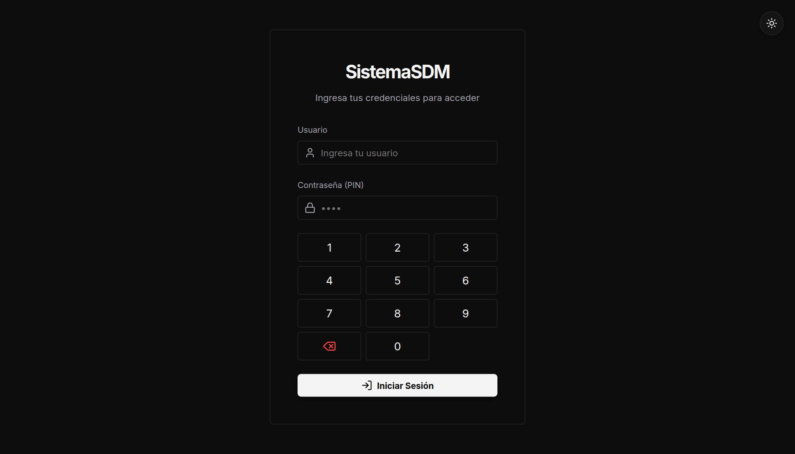
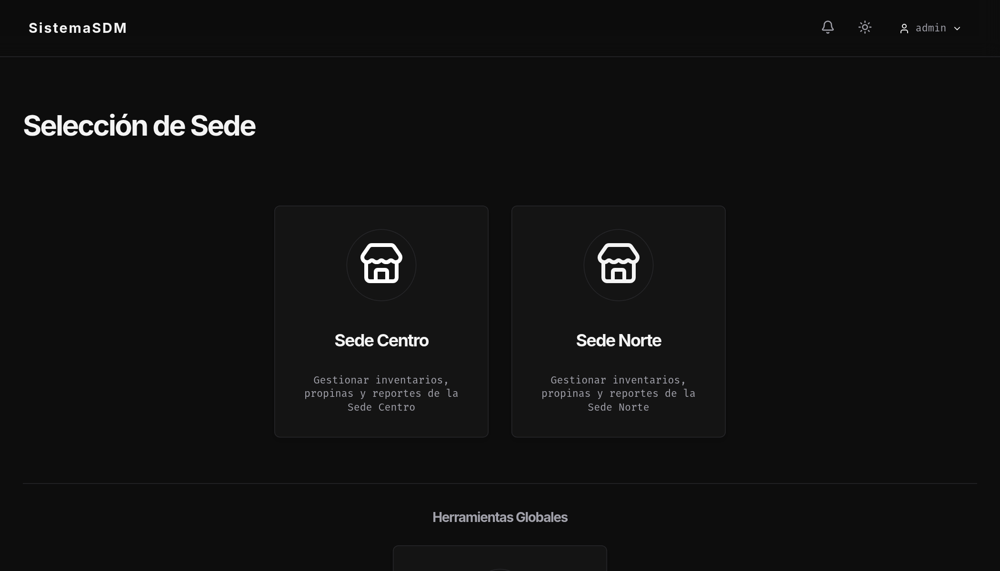
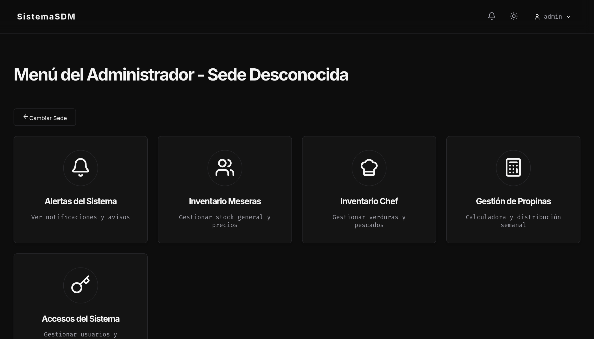
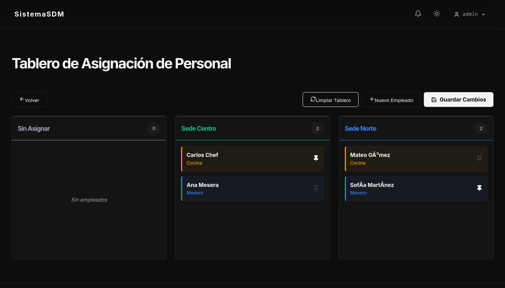
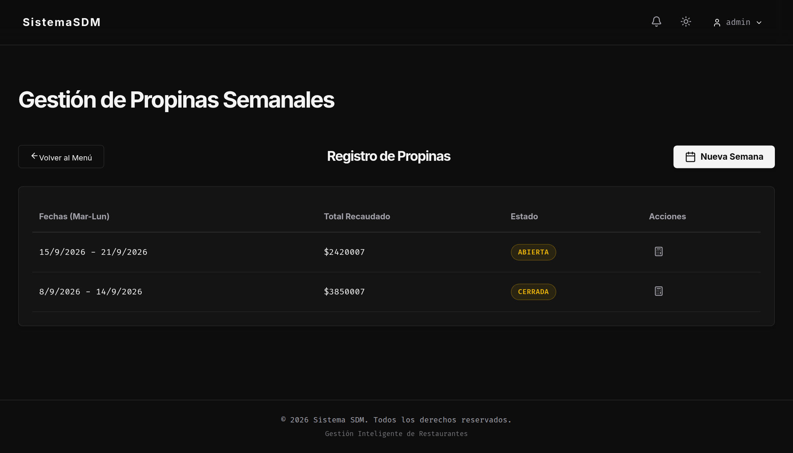
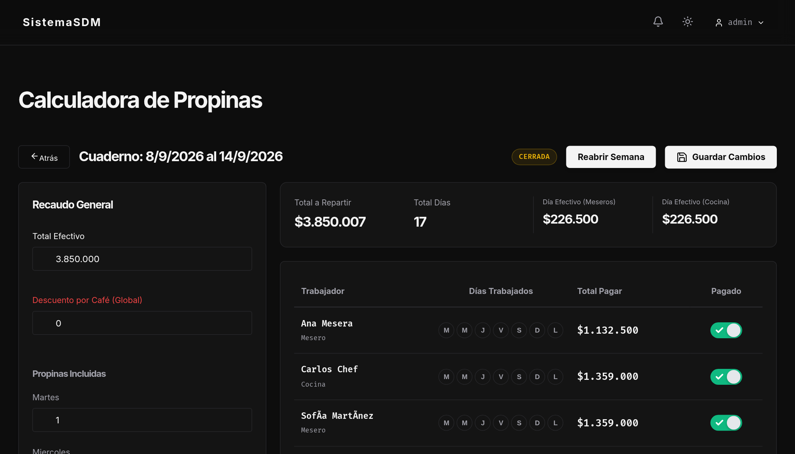
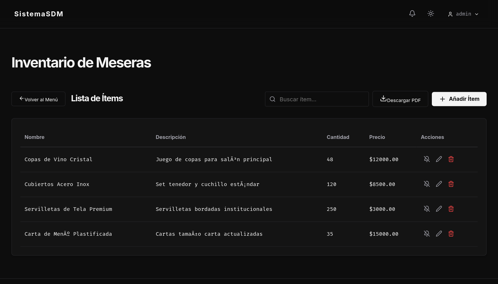
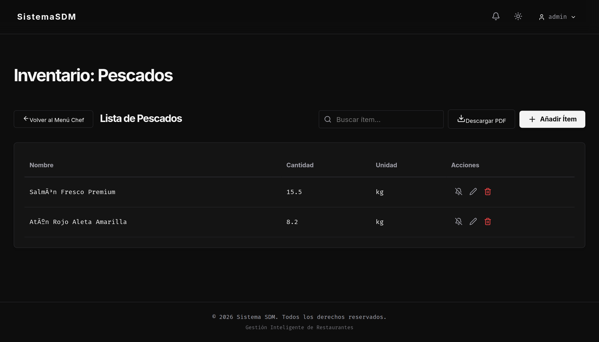
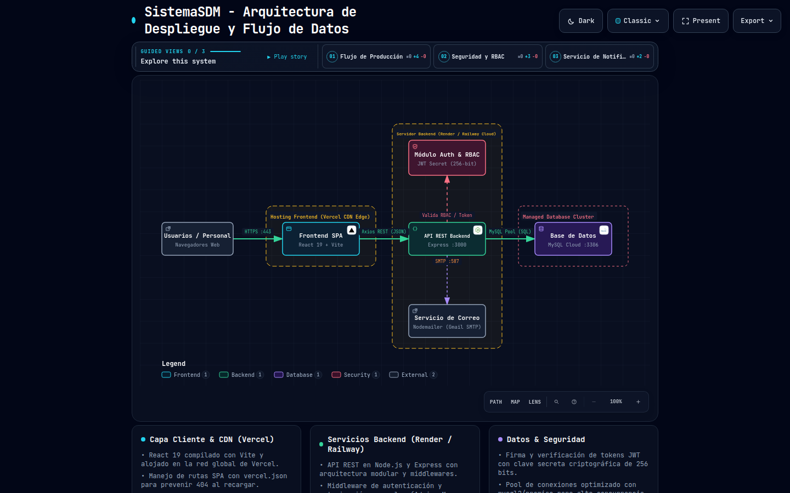
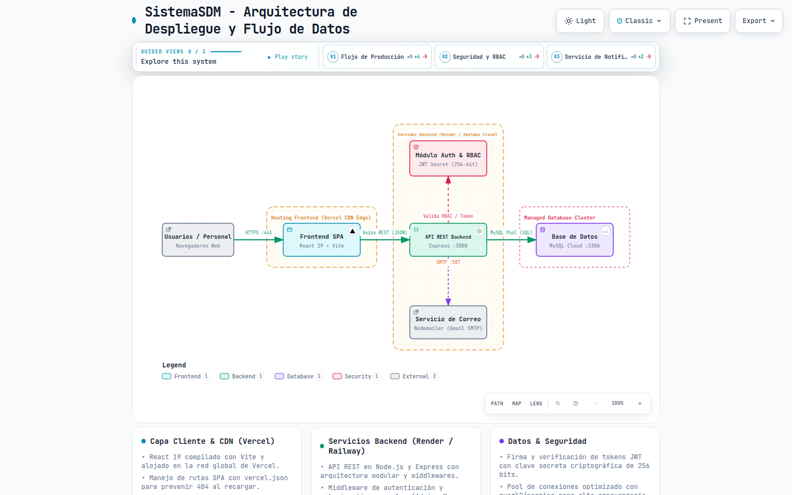

<div align="center">


# 🍽️ SistemaSDM - Frontend Web Application

**Interfaz de Usuario Moderna, Reactiva y Responsiva para Gestión Gastronómica Multi-Sede**  
*Control de Insumos • Tablero Kanban de Personal • Liquidación Interactiva de Propinas • Exportación PDF*

[](https://react.dev/)
[](https://vitejs.dev/)
[](https://reactrouter.com/)
[](https://vitest.dev/)
[](https://lucide.dev/)
[](https://sonner.emilkowal.ski/)

</div>

---

## 📌 Visión General

**SistemaSDM Frontend** es una Single Page Application (SPA) de alto rendimiento desarrollada con **React 19** y empaquetada con **Vite**. Diseñada específicamente para pantallas táctiles de puntos de venta (POS), tablets de cocina y computadores administrativos de restaurante, ofrece una experiencia de usuario rápida, fluida y con un diseño estético en modo oscuro y claro.

---

## 📸 Galería de Interfaces

### 1. 🔐 Acceso Seguro con Teclado Numérico y Guardias RBAC
Inicio de sesión optimizado para terminales táctiles con teclado numérico en pantalla y soporte simultáneo para teclado físico. Incluye alternancia instantánea entre modo oscuro y claro.

<div align="center">



</div>

---

### 2. 🏢 Selección de Sede y Menú Central de Administración
Gestión multi-sucursal que permite a los administradores alternar el contexto operativo entre sedes (`Sede Centro`, `Sede Norte`) y acceder a los diferentes módulos mediante tarjetas interactivas.

<div align="center">

| Selección de Sede | Hub Central de Administración |
| :---: | :---: |
|  |  |

</div>

---

### 3. 📋 Tablero Kanban de Asignación de Turnos y Personal
Módulo visual con capacidad de **Drag & Drop** (`@dnd-kit`) para organizar cuadrillas de trabajo por turnos y sedes, con funcionalidad de fijado de puesto mediante chincheta y guardado por lote.

<div align="center">



</div>

---

### 4. 💰 Motor y Calculadora Interactiva de Liquidación de Propinas
Historial consolidado de semanas operativas y calculadora matemática en vivo que desglosa el recaudo efectivo, días asistidos, deducciones de café y cálculo proporcional para cocina y salón con opción de reabrir o cerrar periodos.

<div align="center">

| Historial de Ciclos Semanales | Calculadora de Distribución en Vivo |
| :---: | :---: |
|  |  |

</div>

---

### 5. 📦 Control de Inventarios con Filtros y Exportación PDF
Paneles especializados por rol: control de insumos y cristalería para el salón (Meseras) y control clasificado por categorías de ingredientes culinarios (Chef), con generación instantánea de informes PDF formateados.

<div align="center">

| Inventario de Salón (Meseras) | Inventario de Cocina (Chef) |
| :---: | :---: |
|  |  |

</div>

---

## ✨ Características Técnicas Destacadas

- **🛡️ Rutas Protegidas y RBAC (`ProtectedRoute.jsx`):** Validación en cliente del rol (`Admin`, `Chef`, `Mesera`). Redirección automática y protección contra accesos no autorizados.
- **⏱️ Cierre de Sesión por Inactividad (`useInactivityLogout.js`):** Escucha pasiva de eventos (`mousemove`, `keydown`, `touchstart`, `scroll`) con temporizador inteligente para proteger terminales desatendidas en el restaurante.
- **⚡ Centralización de Peticiones HTTP (`api.js`):**
  - Inyección automática del token Bearer JWT en los encabezados.
  - Inyección transparente de la sede seleccionada en los parámetros.
  - Captura y manejo de respuestas `401 Unauthorized` para redirección limpia al login.
- **📄 Reportes Dinámicos en PDF:** Generación de documentos corporativos del inventario en el navegador usando `jspdf` y `jspdf-autotable`.
- **🎨 Notificaciones Sonner:** Feedback visual elegante ante operaciones exitosas, advertencias y fallos de conexión.

---

## 🏛️ Arquitectura del Sistema y Despliegue (Generado con Archify)

La integración del frontend con la infraestructura en la nube (Vercel CDN), el backend Express y los servicios periféricos ha sido modelada y validada mediante **[Archify](https://github.com/tt-a1i/archify)**:

<div align="center">

| Modo Oscuro | Modo Claro |
| :---: | :---: |
|  |  |

> 💡 **Diagrama Interactivo:** Puedes abrir [`docs/sistemasdm-arquitectura.html`](docs/sistemasdm-arquitectura.html) en tu navegador para interactuar con el lienzo (Zoom, Pan, visualización por capas guiadas y exportación vectorial).

</div>

---

## 🗂️ Estructura del Código Fuente

```text
SistemaSDMfront/
├── 📁 docs/
│   └── 📁 assets/                    # Capturas de pantalla y banner oficial
├── 📁 public/                        # Activos estáticos públicos
├── 📁 src/
│   ├── 📁 components/
│   │   ├── InactivityHandler.jsx     # Componente global de control de inactividad
│   │   ├── Layout.jsx                # Estructura base con barra superior y navegación
│   │   ├── ProtectedRoute.jsx        # HOC Guard para validación de roles
│   │   └── SkeletonLoaders.jsx       # Marcadores de posición animados durante cargas
│   ├── 📁 hooks/
│   │   └── useInactivityLogout.js    # Hook desacoplado de logout automático
│   ├── 📁 pages/
│   │   ├── Login.jsx                 # Acceso táctil con teclado numérico
│   │   ├── AdminSedes.jsx            # Selector de sucursales
│   │   ├── AdminMenu.jsx             # Hub administrativo
│   │   ├── AdminAlerts.jsx           # Panel de alertas de stock y avisos
│   │   ├── AdminUsuarios.jsx         # CRUD de usuarios y roles
│   │   ├── AdminPropinas.jsx         # Lista histórica de liquidaciones
│   │   ├── PropinasCalculadora.jsx   # Planilla interactiva de liquidación
│   │   ├── TableroAsignaciones.jsx   # Kanban de turnos con Drag & Drop
│   │   ├── ChefMenu.jsx              # Menú de categorías gastronómicas
│   │   ├── ChefInventory.jsx         # Gestión de existencias de cocina
│   │   ├── MeseraMenu.jsx            # Menú principal de meseras
│   │   └── MeseraInventory.jsx       # Inventario de consumibles de salón
│   ├── 📁 services/
│   │   ├── api.js                    # Instancia Axios con interceptores JWT
│   │   ├── authService.js            # Servicio de autenticación
│   │   ├── alertaService.js          # Peticiones de notificaciones
│   │   └── propinasService.js        # Comunicación con el motor de propinas
│   ├── 📁 utils/
│   │   └── alerts.js                 # Helpers centralizados para Sonner toasts
│   ├── App.jsx                       # Configuración de rutas y providers
│   ├── index.css                     # Estilos globales y tokens CSS
│   └── main.jsx                      # Entrada principal del DOM de React
├── .env.example                      # Plantilla de entorno para Git
├── .gitignore                        # Exclusiones de Git
├── package.json                      # Dependencias y scripts
└── vite.config.js                    # Configuración de compilación y pruebas Vitest
```

---

## 🛣️ Matriz de Rutas de la Aplicación

| Ruta | Componente | Roles con Acceso | Función |
| :--- | :--- | :---: | :--- |
| `/login` | `Login` | Público | Pantalla de inicio de sesión táctil |
| `/admin` | `AdminSedes` | `Admin` | Selección activa de sucursal |
| `/admin/menu` | `AdminMenu` | `Admin` | Tablero principal de administración |
| `/admin/alertas` | `AdminAlerts` | `Admin` | Centro de alertas y notificaciones |
| `/admin/usuarios`| `AdminUsuarios` | `Admin` | Gestión de cuentas y asignación de roles |
| `/asignaciones` | `TableroAsignaciones`| `Admin`, `Chef`, `Mesera` | Tablero Kanban interactivo de turnos |
| `/propinas` | `AdminPropinas` | `Admin`, `Mesera` | Historial de semanas de propinas |
| `/propinas/:id` | `PropinasCalculadora`| `Admin`, `Mesera` | Calculadora interactiva y reparto |
| `/chef` | `ChefMenu` | `Admin`, `Chef` | Menú de categorías de cocina |
| `/chef/inventario/:categoria` | `ChefInventory` | `Admin`, `Chef` | Tabla de insumos de cocina |
| `/mesera` | `MeseraMenu` | `Admin`, `Mesera` | Menú principal de salón |
| `/mesera/inventario` | `MeseraInventory` | `Admin`, `Mesera` | Inventario de servicio y salón |

---

## ⚙️ Variables de Entorno

Crea tu archivo `.env` en la raíz del frontend a partir de la plantilla incluida:

```bash
cp .env.example .env
```

| Variable | Descripción | Valor Predeterminado |
| :--- | :--- | :--- |
| `VITE_API_URL` | URL base de los endpoints de la API backend | `http://localhost:3000/api` |

---

## 🚀 Instalación y Desarrollo Local

### 1. Requisitos
- **Node.js** v18 o superior
- **npm** v9 o superior

### 2. Instalación de Dependencias
```bash
npm install
```

### 3. Iniciar el Servidor de Desarrollo (Vite)
```bash
npm run dev
```
La aplicación abrirá por defecto en `http://localhost:5173`.

### 4. Compilación para Producción
```bash
npm run build
```
Genera los archivos optimizados y minificados en la carpeta `dist/`.

---

## 🧪 Pruebas Automatizadas

La suite de pruebas unitarias y de integración está configurada con **Vitest** y **React Testing Library**:

```bash
# Ejecutar suite completa
npm test

# Modo observador interactivo
npm run test:watch
```

### Cobertura de Pruebas:
- **`alerts.test.js`**: Pruebas de disparadores y formateo de notificaciones Toast.
- **`ProtectedRoute.test.jsx`**: Verificación de bloqueos 403 y redirección a login según el rol en `localStorage`.
- **`SkeletonLoaders.test.jsx`**: Renderizado de animaciones de carga durante transiciones.
- **`useInactivityLogout.test.jsx`**: Verificación del temporizador y reseteo por eventos de usuario.
- **`Login.test.jsx`**: Pruebas de integración del flujo de autenticación y teclado numérico.

---

<div align="center">
Desarrollado con dedicación para el ecosistema <b>SistemaSDM</b>.
</div>
